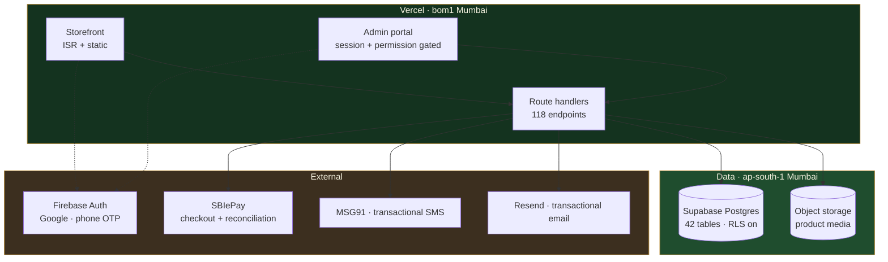

<div align="center">

<picture>
  <source media="(prefers-color-scheme: dark)" srcset="public/brand/logo-horizontal-light.png">
  <source media="(prefers-color-scheme: light)" srcset="public/brand/logo-horizontal.png">
  
</picture>

### Born in soil. Built for tomorrow.

Farm-to-table commerce for **Nutri Greenz Farm Technologies** — single-origin,
lab-tested produce, traceable to the farm that grew it.

<br>

[](https://nextjs.org)
[](https://react.dev)
[](https://www.typescriptlang.org)
[](https://tailwindcss.com)

[](https://nutrigreenz.farm)
[-14331F?style=flat-square&labelColor=0A1F12)](#platform)
[](#)

</div>

---

## What this is

A single Next.js application carrying three products at once:

- a **storefront** where customers browse, trace and buy,
- a **customer account** covering orders, addresses, wishlist, loyalty and referrals,
- an **operations portal** where the team runs catalogue, inventory, orders, farms, marketing and people.

It is not a template build. Everything from the promotion engine to the
delivery-serviceability rules is written against how this business actually
operates: same-day dispatch windows, pincode-level coverage across Hyderabad,
lab reports attached to lots, and stock reserved at the variant level so two
people cannot buy the last 1L jar.

<div align="center">

| | | | |
|:--:|:--:|:--:|:--:|
| **72** | **118** | **137** | **100** |
| pages | API routes | components | lib modules |

</div>

---

## Architecture



Functions and database sit in the same region on purpose. They used to run
from Washington DC against a Tokyo database, and every admin page load crossed
the Pacific twice.

---

## Surfaces

<table>
<tr>
<td width="33%" valign="top">

### Storefront
Home · shop · product detail
Farms · traceability · lab
Journal · about · press
Cart · checkout · confirmation
Community · wholesale · careers

</td>
<td width="33%" valign="top">

### Account
Profile · addresses
Orders and tracking
Wishlist · loyalty
Referrals · rewards

</td>
<td width="33%" valign="top">

### Operations
Orders · inventory · catalog
Customers · people · captains
Farms · journal · marketing
Analytics · reports · audit
Config · feature flags

</td>
</tr>
</table>

---

## Stack

| Layer | Choice |
|---|---|
| Framework | Next.js 16 (App Router), React 19, TypeScript strict |
| Styling | Tailwind CSS v4 with `@theme` design tokens |
| Type | Fraunces (display) · Hanken Grotesk (body) · JetBrains Mono (data) |
| Icons | Solar via Iconify |
| Motion | Framer Motion |
| Database | Supabase Postgres, RLS enabled on every table |
| Auth | Firebase Auth — Google sign-in and phone OTP |
| Payments | SBIePay, with a nightly reconciliation cron |
| Messaging | MSG91 (SMS) · Resend (email) |
| Hosting | Vercel |

---

## Getting started

```bash
npm install
cp .env.example .env.local     # fill in the values
npm run dev                    # http://localhost:3000
```

### Scripts

| Command | What it does |
|---|---|
| `npm run dev` | Development server |
| `npm run build` | Production build |
| `npm run start` | Serve the production build |
| `npm run lint` | ESLint |
| `npm run typecheck` | `tsc --noEmit` |
| `npm run check` | Lint, typecheck and build — run before pushing |

---

## Project structure

```
src/
  app/                 72 routes — storefront, account, checkout, admin, 118 API handlers
  components/ng/       the Nutri Greenz UI system
    sections/          home and landing sections
    pdp/               product detail
    commerce/          cart, checkout, pricing
    account/           customer account
    admin/             operations portal
    ui/                primitives
  lib/                 domain logic — promotions, commerce rules, badges,
                       serviceability, sanitisation, auth, sessions, mail
  types/               shared types
public/
  brand/               logo lockups, light and dark
  images/              product, hero and editorial imagery
supabase/migrations/   schema history
nutrigreenz-packaging/ label and packaging specification
docs/                  architecture, brand and compliance notes
```

---

## Engineering notes

<details>
<summary><b>Rendering and caching</b></summary>

<br>

Product and category pages are statically generated with `generateStaticParams`
and revalidated on a timer. A dynamic segment carrying only `revalidate` is
never actually cached — it compiles as dynamic and the revalidate column stays
empty — which is a quiet way to lose every bit of your caching.

</details>

<details>
<summary><b>Promotions</b></summary>

<br>

Offers resolve at four scopes: site-wide, category, product and single variant.
Variant-scoped pricing is applied on the order path as well as the display
path, so the price a customer is shown is the price they are charged. A live
promotion takes the hero banner on its own rather than rotating against the
evergreen slides.

</details>

<details>
<summary><b>Stock</b></summary>

<br>

Stock is reserved and released through database functions rather than
application code, so concurrent checkouts on the last unit of a variant settle
in the database instead of racing in Node.

</details>

<details>
<summary><b>Input handling</b></summary>

<br>

Free text is length-checked and stripped of invisible and control characters at
the route boundary. Over-length input is rejected with a 400 rather than
silently truncated — truncation both fails an audit and destroys the customer's
work. Multiline fields normalise line endings before stripping controls, since
the C0 range contains the newline itself.

</details>

<details>
<summary><b>Access control</b></summary>

<br>

Admin APIs self-guard per permission rather than per role, so revoking a
section actually revokes the JSON endpoint behind it and not merely the page.
Sessions are signed, httpOnly and carry a token version that a password reset
or a "log out everywhere" invalidates.

</details>

---

## Platform

Application data is resident in India (`ap-south-1`), with serverless functions
in the same region. Transactional logs and access records are retained in line
with CERT-In directions, and the storefront carries its FSSAI licence on every
page.

---

## License

See [LICENSE](LICENSE). Brand assets, photography, packaging artwork and
product copy are the property of Nutri Greenz Farm Technologies Pvt. Ltd. and
are not covered by it.

<div align="center">
<br>
<sub>Built in Hyderabad.</sub>
</div>
