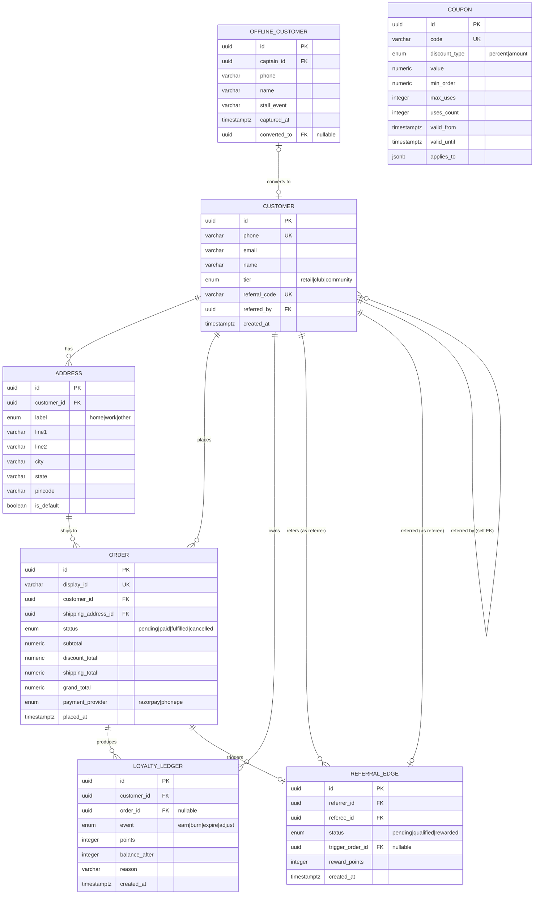

# Nutrigreenz — Core Data Model (ERD)

> [!NOTE]
> **Original conceptual ERD, written at the start of the engagement.** It models
> the core commerce entities, not the full schema — the live database has 42
> tables. Verified on 2026-09-15: `customers`, `addresses`, `orders`, `coupons`
> and `loyalty_ledger` exist as modelled. `OFFLINE_CUSTOMER` and `REFERRAL_EDGE`
> were folded into other tables rather than built as standalone ones.

> 7 entities, 10 relationships. Renders at full size in any Mermaid viewer.

## Key invariants

| Invariant | Enforced by |
|---|---|
| One default address per customer | Partial unique index on `address(customer_id) where is_default=true` |
| Loyalty balance never negative | DB check constraint on `balance_after >= 0` |
| Referral edge unique per pair | Unique constraint on `(referrer_id, referee_id)` |
| Self-referral blocked | Check constraint `referrer_id <> referee_id` |
| Coupon uses_count <= max_uses | DB check + advisory lock on apply |
| Order grand_total = subtotal − discount + shipping | Computed in service, validated by DB trigger |

## Why Coupon has no FK

`Coupon` is intentionally decoupled — `applies_to` is a JSONB shape (`{"sku_ids": [...]}` or `{"categories": [...]}`) so we can change scoping logic without a migration. The link to an order is captured implicitly in `Order.discount_total` and an `order_coupon` audit row (not shown here, can be added if needed).
